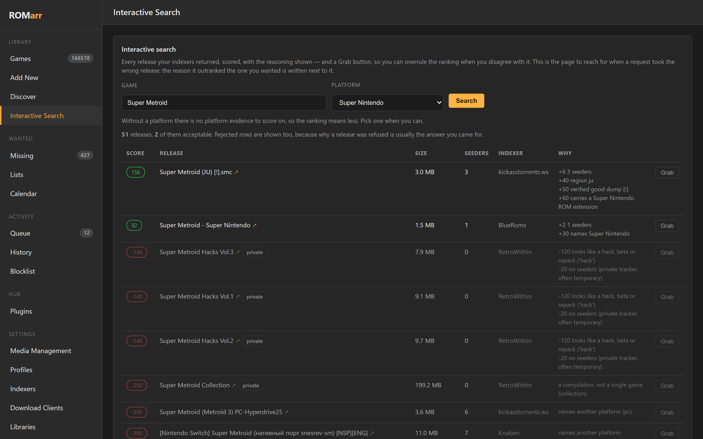

# ROMarr

The *arr for games.

Find games, verify ROMs, and import them into your library.

[](https://github.com/BlizzHacker/romarr/actions/workflows/docker.yml)
[](LICENSE)

**[Install](#install)** · **[First setup](docs/GETTING-STARTED.md)** · **[Plugins](docs/PLUGINS.md)** · **[Roadmap](ROADMAP.md)** · **[Releases](https://github.com/BlizzHacker/romarr/releases)**



## What can I use it for?

| I want to… | Start here | What you need |
|---|---|---|
| Import ROMs I already have | **Manual Import** | A destination folder and access to the source files. No indexer or download client needed. |
| Find and download a particular game | **Add New** or **Interactive Search** | A search source, a matching download client, and a destination folder. |
| Check what a collection is missing | **Collections** | A No-Intro or Redump DAT and your local library. |
| Reclaim space taken by exact duplicates | **Stats → Audit** | A local library; review the preview before moving duplicates to quarantine. Restore is available. |
| Add another game source | **Hub → Plugins** | ROM Hub, included in the Windows app and amd64/arm64 Docker images. [Details](docs/PLUGINS.md). |

You can use a plain **folder** as your library. RomM, Gaseous, Retrom and other library integrations are optional. Your emulator or frontend plays the games; ROMarr handles finding, checking and importing files.

Imports can be checked against DAT checksums. The result is **verified**, **bad dump**, or **unknown**. Without a matching DAT, a file is unknown; that does not mean it is damaged. **Rename on import** can use a verified single-file ROM's DAT name while keeping its source extension; unknown filenames are retained and existing files are not overwritten. A bulk, in-place rename planner for existing libraries is on the [roadmap](ROADMAP.md).

## Install

### Choose a method

| Method | Best fit | Guide |
|---|---|---|
| **Docker Compose** | Most servers, NAS hosts, or Docker Desktop | [Quick start below](#docker-compose-quick-start) |
| **Proxmox LXC** | A Proxmox host | [LXC installer](docs/INSTALL.md#proxmox-lxc) |
| **Windows app** | Windows 10/11 on x64 | [Download the Windows ZIP](docs/INSTALL.md#windows-app), extract it and double-click **ROMarr.exe**. No Python, PowerShell or .NET installation required. |
| **Linux/macOS source checkout** | Development or an existing Python host | [Source instructions](docs/INSTALL.md#from-source) |
| **Home Assistant add-on** | A Home Assistant installation | [Add-on instructions](docs/INSTALL.md#home-assistant); this packaging needs more field testing. |

For Docker, have Docker Engine or Docker Desktop with Compose installed. Reserve port **6868** and choose where settings, downloads, and ROMs will live. ROMs and download space are usually much larger than the app itself.

### Docker Compose quick start

These commands are for a Linux or macOS shell, or an SSH terminal on your Docker host. They create a new folder library. If you already use RomM or another library, mount its real ROM directory instead of `./roms`.

```bash
mkdir -p romarr/config romarr/roms romarr/downloads
cd romarr
```

Save this as `compose.yaml` in that directory:

```yaml
services:
  romarr:
    image: ghcr.io/blizzhacker/romarr:latest
    container_name: romarr
    restart: unless-stopped
    ports:
      - "6868:6868"
    environment:
      PUID: 1000
      PGID: 1000
      UMASK: "002"
      TZ: Etc/UTC
      LIBRARY_KIND: folder
      LIBRARY_PATH: /roms
    volumes:
      - ./config:/config
      - ./roms:/roms
      - ./downloads:/downloads
```

Set `PUID` and `PGID` to the numeric owner/group of your ROM and download folders (`id -u` and `id -g` on Linux), then start:

```bash
docker compose up -d
```

Open **http://localhost:6868** on that computer, or **http://YOUR-SERVER-IP:6868** from another device. Set a password, then follow **Settings → Setup Guide** (`/#setup`). You can skip steps you do not need and reopen the guide later.

Already have a download client? Its completed files must be visible to ROMarr. If the client reports `/downloads`, both containers should use that path for the same files. A client in a different container is reached by its Docker service name on a shared network, or by its host's address; `localhost` inside ROMarr means ROMarr itself. [Path examples and troubleshooting](docs/GETTING-STARTED.md#paths-that-need-to-agree).

The image includes archive tools. **ROM Hub is included on amd64/arm64; it is unavailable in the armv7 image.** [Image tags, permissions, backup and updates](docs/INSTALL.md).

## Get your first result

**Already have ROMs?** Put one file in the mounted downloads folder, open **Manual Import**, and scan `/downloads`. Check the platform and verification result before pressing **Import**. [Walkthrough](docs/GETTING-STARTED.md#import-a-rom-you-already-have).

**Want automatic downloads?** Add a library, a download client and a search source in **Setup Guide**. Use **Interactive Search** for your first game so you can inspect the results before grabbing one. Follow it through **Queue** and **History**. [Walkthrough](docs/GETTING-STARTED.md#find-and-download-a-game).

**Want plugins?** Open **Hub → Plugins**, choose a plugin, click **Install**, and add a **ROM Hub** download client for searchable plugins. ROM Hub is the plugin host; each plugin adds a particular source or capability. [Available examples and exact steps](docs/PLUGINS.md).

## What else is included?

- Wanted lists and scheduled searches, with the reason shown when a release is rejected.
- Prowlarr, Torznab/Newznab and torrent RSS sources; torrent, Usenet and plugin download clients.
- DAT collection comparison, region/1G1R selection, and staged acquisition from an existing qBittorrent set torrent.
- Exact duplicate audit, quarantine and restore; a preview comes before any move.
- Multiple library destinations, notifications, import lists and frontend exports.
- PS4, PS5 and PS Vita search/import formats, with [explicit playback and installation limits](docs/MODERN-CONSOLES.md).

Source access, available files, credentials and platform support vary. Check the result and the task history; a configured connection does not guarantee a particular game is available.

## Play with Cartridge

[Cartridge for Windows](https://github.com/BlizzHacker/romarr/releases/download/v1.8.0/Cartridge-Windows-Portable-0.2.0-x64.exe) and [Cartridge for Xbox](https://github.com/BlizzHacker/RommForXbox) are optional players for a RomM library. Choose the app for your device. ROMarr manages acquisition and imports; Cartridge connects to RomM to browse and play. You can keep using your existing frontend instead. The Windows app's **Cartridge** menu and the Setup Guide link to both.

## Help and documentation

| Need | Read |
|---|---|
| First setup and a successful import | [Getting started](docs/GETTING-STARTED.md) |
| Installation, Windows, backups, updates and environment variables | [Install guide](docs/INSTALL.md) |
| Plugin availability and installation | [ROM Hub guide](docs/PLUGINS.md) |
| API, library routing, players and browser downloads | [Feature reference](docs/FEATURES.md) |
| Current work and requested features | [Roadmap](ROADMAP.md) |
| Test evidence and known validation gaps | [Proof notes](docs/PROOF.md) — dated records, not a guarantee for every integration |

If something fails, [open an issue](https://github.com/BlizzHacker/romarr/issues/new) with your ROMarr version, install method, the action you tried, and the relevant error or log. Remove passwords, API keys and webhook URLs. Existing-install settings are changed in the UI; most connection environment variables only seed the first run.

## Contribute

Bug reports, documentation fixes and integration field reports are welcome. For code changes, install the [source environment](docs/INSTALL.md#from-source), install `pytest`, and run `python -m pytest tests/ -q`. The [CI workflow](.github/workflows/docker.yml) runs the suite and image smoke checks.

Source plugins live in [ROM Hub](https://github.com/BlizzHacker/rom-hub); see its [contribution guide](https://github.com/BlizzHacker/rom-hub/blob/master/CONTRIBUTING.md). ROMarr's API schema is available at `/api/v1/openapi.json` on your own install.

Thanks to the library, emulator and preservation projects ROMarr works with, and to [Radarr](https://github.com/Radarr/Radarr), [Sonarr](https://github.com/Sonarr/Sonarr), [Questarr](https://github.com/Doezer/Questarr) and [gamarr](https://github.com/JeremiahM37/gamarr) for ideas and familiar workflows.

MIT — [LICENSE](LICENSE). ROMarr is an independent project and is not endorsed by its integrations.
