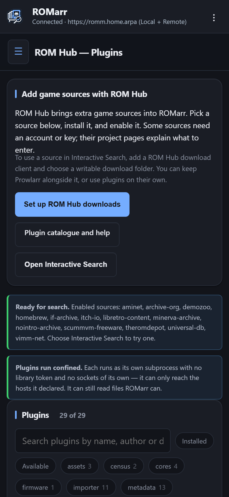
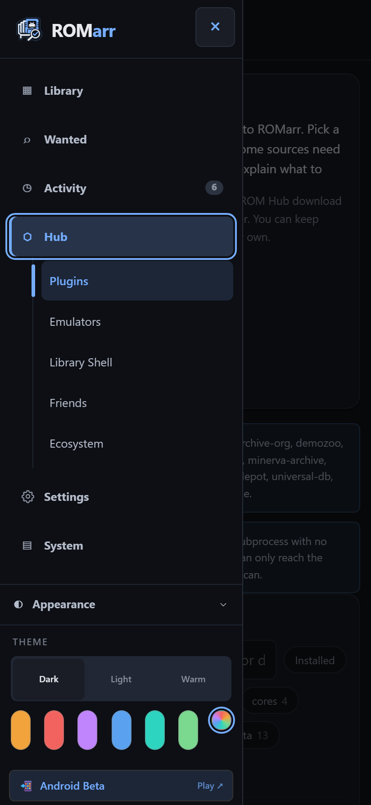

# ROMarr for Android

The native Android host bundles the ROMarr Python server and UI using Chaquopy.
It starts on an ephemeral **127.0.0.1-only** port and stores state, DATs and ROMs
inside the application's private files directory. Python is included in the APK:
there is no Termux, Docker, browser server, or separately installed Python requirement.
Internet sources and remote servers still require a network connection.

Minimum Android version: Android 7.0 (API 24). Target/compile API: 36.
Packaged architectures: ARM64 and x86_64. This is an installable Android application,
including on compatible Android desktop environments; it is not a Linux desktop binary.

## Google Play Beta & Direct APK Downloads

ROMarr is available for Android in two convenient ways:

1. 📲 **Google Play Closed Beta Track (12 Testers Needed)**:
   👉 **[Join the Android Beta on Google Play](https://play.google.com/apps/internaltest/4700888732790045566)**  
   Opting in allows direct install and automatic updates from Google Play on your phone, tablet, or gaming handheld.

2. 📦 **Direct APK Sideload (GitHub Releases)**:
   👉 **[Download the Latest APK from Releases](https://github.com/BlizzHacker/romarr/releases)**  
   Self-contained APK with Chaquopy Python runtime embedded. Install directly on any ARM64 or x86_64 device running Android 7.0+ without waiting for Google Play approval or needing Termux/Docker.

## Argosy Launcher and Frontend Integration

ROMarr includes native RomM v5 API compatibility. This allows mobile launchers and frontend apps originally built for RomM to use ROMarr directly as their backend server.

### Connecting Argosy Launcher

[Argosy Launcher](https://github.com/rommapp/argosy-launcher) is an open-source, controller-first Android launcher designed for retro gaming handhelds.

To pair Argosy with ROMarr:
1. Ensure ROMarr is running (either locally on your Android device or on your home server/NAS at `http://<your-server-ip>:6868`).
2. Open **Argosy Launcher** on your Android device.
3. In the server setup screen, enter your ROMarr URL:
   - For local ROMarr on the same device: `http://127.0.0.1:6868`
   - For remote server: `http://<lan-ip>:6868` or your HTTPS domain.
4. Argosy queries `/api/heartbeat`, `/api/users/me`, `/api/permissions/me`, and `/api/platforms`.
5. ROMarr's standalone portal proxy responds with full RomM 5.1.0-compatible capabilities, letting Argosy discover your platforms, library ROMs, box art, and metadata.

### Handheld Gaming Devices & Controller Navigation

ROMarr and Argosy Launcher are optimized for modern Android gaming handhelds, including:
- **Ayn Odin 2 / Odin 2 Mini / Odin Pro**
- **Retroid Pocket 4 Pro / Retroid Pocket 5 / Retroid Pocket Mini / Retroid Pocket 3+**
- **Anbernic RG556 / RG Cube / RG405M / RG505**
- **Logitech G Cloud / Razer Edge / Pimax Portal**

### Compatible Android Emulators

Files in your library can be launched directly into installed emulators via Android's `ACTION_VIEW` intent and FileProvider:
- **RetroArch** (`com.retroarch` / `com.retroarch.aarch64`)
- **Dolphin Emulator** (`org.dolphinemu.dolphinemu`)
- **DuckStation** (`com.github.stenzek.duckstation`)
- **PPSSPP** (`org.ppsspp.ppsspp` / `org.ppsspp.ppssppgold`)
- **NetherSX2 / AetherSX2** (`xyz.aethersx2.android`)
- **Citra / Lime3DS / Citra Enhanced** (`org.citra.citra_emu`)
- **Vita3K Android** (`org.vita3k.emulator`)
- **Mupen64Plus FZ** (`org.mupen64plusae.v3.fzurita`)

## Use

| Android Home & Top Toolbar | Slide-Out Drawer & Appearance |
|---|---|
|  |  |

The dark native toolbar keeps the active device or server visible above the app.
Open **ROMarr menu** (⋮) for **This device**, **Servers**, **Import ROM or DAT**,
**Play a local file**, **Connection details**, and **Privacy policy**. The privacy
policy opens `https://romarr.app/privacy` in your system browser without changing
the selected server or exposing its session. Long server names shorten on
small screens; Connection details shows the complete address. The toolbar and
WebView respect system bars, display cutouts and the on-screen keyboard.

- **This device** opens the bundled server. The native host preclaims this listener with an ephemeral secret and supplies
  a private HttpOnly session cookie before loading the UI. Other local apps cannot
  claim setup or use protected APIs without that session. Configure library platforms, indexers and download clients through its UI.
- **Servers** saves named HTTPS server origins and switches between them and the local
  library. Credentials are entered into each server's normal sign-in page; profile
  URLs reject embedded credentials, paths, queries and fragments. A trusted TLS
  certificate is required. Plain HTTP remote servers are deliberately unavailable.
  If the server redirects to another HTTPS authority for single sign-on, ROMarr
  asks permission in a native dialog showing only the server and sign-in authorities.
  Approved sign-in stays in the same WebView so normal first-party cookies can return
  to the server. Cross-authority form POSTs are blocked before their body is sent
  until that authority is approved. Approval returns to the server with a GET;
  retry sign-in there. The blocked form body is never replayed. Switching profiles/device mode cancels pending consent and resets
  that selection's sign-in trust. Regular external links open in the system browser;
  TLS errors are never bypassed. Some identity providers restrict embedded browsers.
- **Import** uses Android's system document picker to copy an explicitly selected ROM
  into private `library/Imported`, or a DAT/XML/ZIP into private `dats` and reload
  the checksum catalogue. Scan the imported library folder in ROMarr. A copied ROM
  is not described as verified until the core actually verifies it against a DAT.
  Existing filenames are preserved by atomic non-replacing publication with a new
  destination name on collision. Imports fail closed on kernels lacking that primitive.
- **Play file** grants temporary read access to one chosen local ROM through
  FileProvider and Android's ACTION_VIEW chooser. Only installed emulators accepting
  `content:` URIs and this MIME type can handle it. Some emulators need their own
  picker or a different intent contract. BIOS, emulator installation, archive
  extraction and compatibility are separate requirements. No emulator is bundled.
  Quarantine and all `.romarr*` internal directories are excluded from file listings
  and rejected again before emulator handoff.

The local server lives in the app process. It may continue briefly after navigating
away, but **Android can suspend or terminate it**. There is no persistent background
service or unattended download guarantee. Use remote server mode for always-on work.
Closing/reopening the UI reuses the in-process server; a new process reloads persisted
state and reconciles integration requests interrupted during dispatch. Scheduled imports,
Wanted searches, RSS sync, failed-download handling and list sync use the normal
core scheduler while the process remains alive. Android uninstall / Clear storage removes the private library and profiles.

The shared ROMarr UI and HTTP integrations run locally; native desktop executables,
ROM Hub subprocess plugins, Playwright/Chromium downloads, self-updates, native
emulator installers, 7-Zip/unrar/bsdtar and shell tooling are not bundled.
ZIP support uses the Python standard library. Configure external download clients
and remote services only when reachable from the Android device. File permissions,
CA trust and Android process lifetime differ from Windows. Python requests uses
Chaquopy/certifi trust; WebView uses Android TLS trust.

## Build on the server volume

Use JDK 17, Gradle 8.13, Python 3.13, Android SDK platform 36, build tools 36.0.0 and
platform-tools. The build pins AGP 8.13.0, Chaquopy 17.2.0 and Python requirements.
No frontend build is used. Source staging includes Python and JSON catalogues
directly from `romarr/`; it never copies credentials or checkout metadata.

```bash
# Run on root@192.168.0.6; keep toolchains, caches and outputs on /opt/repos.
df -h /opt/repos
export JAVA_HOME=/path/on/opt/repos/to/jdk17
export ANDROID_HOME=/path/on/opt/repos/to/android-sdk
export ROMARR_BUILD_PYTHON=/path/on/opt/repos/to/python3.13
export GRADLE_USER_HOME=/opt/repos/ai-state/wadei/romarr-android/gradle-home
export PIP_CACHE_DIR=/opt/repos/ai-state/wadei/romarr-android/pip
export ANDROID_USER_HOME=/opt/repos/ai-state/wadei/romarr-android/android-home
export PATH="$JAVA_HOME/bin:$PATH"
./scripts/build-android.sh
# Optional connected emulator/device checks:
./scripts/build-android.sh connectedDebugAndroidTest
```

Outputs are under `desktop/android/app/build/outputs/`:
`apk/debug/app-debug.apk` is debug-signed for testing;
`apk/release/app-release-unsigned.apk` and `bundle/release/app-release.aab` are
unsigned by default. To sign a release, set `ROMARR_ANDROID_SIGNING` to an absolute
private Java properties file containing storeFile, storePassword, keyAlias and
keyPassword. Signed APK output is `apk/release/app-release.apk`. Never put that
file, keystore, or password inside the checkout.

The 1.10.x previews use a persistent owner-controlled preview certificate
with SHA-256 fingerprint
`76ade6d94d71536eeacc5d87c4db4d05a877d7c0410d3a94b8c307d9fe69868c`.
Its PKCS12 key, password and signing properties are private mode-0600 files under
`/opt/repos/ai-state/wadei/romarr-android`, outside Git and release artifacts.
The owner must arrange an encrypted private backup of the key and password before
relying on update continuity; losing it prevents updates to that signed install.
This is a preview distribution identity, not proof of a verified Play publisher.
A future different Play signing identity may require uninstall/reinstall.

The 12-test API 36 instrumentation suite includes native toolbar/WebView bounds,
long server names and actual keyboard resize checks. The layout case also runs
at 360 dp width, font scale 1.3, and 640 × 360 dp landscape. Screenshots and private
exact-source receipts accompany the server build; see [build proof](../desktop/android/BUILD-PROOF.md).

The instrumentation tests run the packaged Python interpreter, start the actual
loopback server, fetch health and UI responses, reject anonymous protected API/setup requests,
authenticate the actual WebView without a JavaScript credential bridge, copy a
user-selected content URI through the native import handler, exercise OpenSSL scrypt/TLS,
and verify FileProvider exposes library files while refusing state files.
A device test result does not prove emulator compatibility or every downloader.
The optional live sign-in test can be enabled with
`-Pandroid.testInstrumentationRunnerArguments.liveSso=true`; it stops after the
configured live identity login page renders, with no credentials entered.
ARM64 physical-device and 16 KB runtime checks remain separate release gates.

## Google Play preparation

Candidate package ID: `org.romarr.android`; confirm ownership before first upload.
Candidate store title: **ROMarr**.
Short description: **Manage your game library on this device and your own servers.**

Draft full description:

> Organize your own game library with ROMarr. Run its included library manager on
> your Android device or connect to your own HTTPS ROMarr servers. Import files
> through Android's document picker, configure checksum DATs, review your library,
> and open local files in compatible installed emulators. No games, BIOS files or
> emulators are included. Source integrations require your own services and access.
> Local work runs while Android keeps the application process alive.

Before submission, the publisher must:

1. Choose the permanent package ID and version, enable Play App Signing and sign
   the release AAB with the owner-held upload key. Do not publish a debug APK.
2. Provide a public privacy policy/support URL, store icon (512x512), feature graphic
   (1024x500), and genuine phone/tablet screenshots from the release build.
3. Complete content rating, app access instructions, target audience, advertising
   declaration, Data safety, and required account/developer verification/testing.
   If login blocks review, provide reviewer access to a nonproduction test server.
4. Review native library ELF and APK 16 KB alignment, test a 16 KB device/emulator,
   test ARM64 physical devices and accessibility/rotation/import/error flows, and
   run Play's pre-launch report. Building an AAB alone is not Play approval.
5. Review integration/content access and intellectual property policies. Distribute
   only application code and authorized assets; the package includes no game files.
6. Increase versionCode for every subsequent upload and recheck current requirements.

Draft data inventory for publisher verification (not a completed legal declaration):

| Data | Handling |
| --- | --- |
| Local ROMs, DATs, library state | Private device storage; removed by Clear storage/uninstall |
| Remote profile names/origins | Private SharedPreferences; backups disabled |
| Server login/session and configured integration credentials | WebView cookies and ROMarr private state; transmitted to the server/services the user configures |
| Searches, source requests, metadata and download client commands | Sent to explicitly configured integrations; their operators have their own retention policies |
| Emulator handoff | One user-selected local file receives a temporary read URI grant |
| Telemetry/ads SDKs | None added by the native host; audit bundled core integrations before disclosure |

Do not claim "no data leaves the device": configured source/metadata requests and
remote management transmit data. Whether a particular transfer is developer
collection, sharing, or an exempt user-directed transfer must be assessed against
the final released integrations and Google's definitions.

Official references:
[Chaquopy build/runtime support](https://chaquo.com/chaquopy/doc/current/android.html),
[Chaquopy version compatibility](https://chaquo.com/chaquopy/doc/current/versions.html),
[Play target API requirements](https://support.google.com/googleplay/android-developer/answer/11926878),
[16 KB support](https://developer.android.com/guide/practices/page-sizes),
[Storage Access Framework](https://developer.android.com/training/data-storage/shared/documents-files),
[FileProvider](https://developer.android.com/reference/androidx/core/content/FileProvider),
[Play App Signing](https://developer.android.com/studio/publish/app-signing),
[Data safety](https://support.google.com/googleplay/android-developer/answer/10787469).
