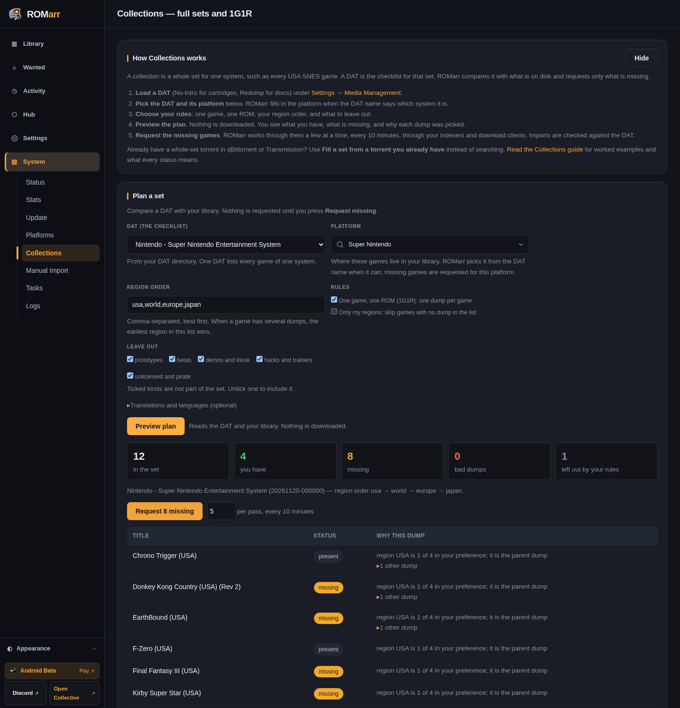

# Collections: whole sets, step by step

**Collections** answers two questions:

- "What is my library missing from a complete set?"
- "Get me the rest of it."

A set is defined by a **DAT**, the official checklist of every known game for one system. A typical example is "every USA Super Nintendo game", one clean copy of each. ROMarr compares the DAT with what is already on disk, shows you the gap, and requests only what is missing.

- [Collections or Wanted?](#collections-or-wanted)
- [Before you start](#before-you-start)
- [Your first set, step by step](#your-first-set-step-by-step)
- [Every option explained](#every-option-explained)
- [Reading the plan](#reading-the-plan)
- [Sets in progress](#sets-in-progress)
- [Filling a set from a torrent you already have](#filling-a-set-from-a-torrent-you-already-have)
- [Worked examples](#worked-examples)
- [Statuses and errors, and how to fix them](#statuses-and-errors-and-how-to-fix-them)
- [FAQ](#faq)
- [API](#api)

## Collections or Wanted?

| You want… | Use |
|---|---|
| One game, or a handful you can name | **Add / Search**, which puts them on **Wanted** |
| Games from a list (a ranking, a Steam-style wishlist) | **Lists**, which syncs into Wanted |
| "Everything for this system", or "everything for this system in my regions" | **Collections** |
| To check how complete a system is, without downloading anything | **Collections**, then press **Preview plan** and stop there |

Collections does not replace Wanted. It is a quick way to request hundreds of games at once, and it uses exactly the same search, scoring, download and import pipeline as a single request.

## Before you start

You need:

1. **An indexer and a download client** (see [Getting started](GETTING-STARTED.md)). Collections searches like any other request. Without these it can only show you the gap.
2. **A library folder for the platform.** ROMarr reads the platform folder (for example `<library>/snes`) to see what you already have. It reads subfolders too, so `Translations/` and multi-disc folders count.
3. **At least one DAT.**
   - Cartridge systems: [No-Intro DAT-o-MATIC](https://datomatic.no-intro.org) (download the "Standard DAT" for a system, or the daily pack).
   - Disc systems: [Redump](http://redump.org/downloads/).
   - Unzip the `.dat` files into one folder ROMarr can read, for example `/dats`.
   - Enter that folder as **DAT directory** under **Settings → Media Management** (or set the `DAT_PATH` environment variable), then save.
   - Large DAT packs take a minute to load. The **System** page shows *DATs loaded* and *Known dumps* when they are ready.

> **Tip:** keep only DATs in that folder. ROMarr reads every `.dat` under it, and pointing it at your whole ROM library makes start-up slow.

## Your first set, step by step

Open **Collections** in the sidebar. The **How Collections works** panel at the top summarises the steps below. **Hide** puts it away, and **How this works** brings it back.

1. **Pick the DAT.** The **DAT (the checklist)** list shows every DAT ROMarr has loaded, by name, for example `Nintendo - Super Nintendo Entertainment System`.
2. **Check the platform.** **Platform** says where these games live in your library and which platform they are requested for. ROMarr fills it in from the DAT name (`… - Super Nintendo Entertainment System` becomes *SNES*). If it stays on *choose the platform this DAT is for*, pick it yourself. Nothing can be requested without one.
3. **Set your rules.** The defaults suit most people: one game, one ROM; regions `usa, world, europe, japan`; prototypes, betas, demos, hacks and unlicensed games left out. Each option is explained [below](#every-option-explained).
4. **Press Preview plan.** Nothing is downloaded. You see how many games are in the set, how many you have, and how many are missing, plus a table explaining why each dump was chosen.
5. **Press Request N missing.** ROMarr creates a *set* under **Sets in progress** and works through it a few titles at a time. The default is 5 titles per pass, with a pass every 10 minutes. Press **Run next** to do a pass immediately.
6. **Watch it arrive.** Each requested title shows up where any request does:
   - **Queue**: a release was found and handed to your download client.
   - **Wanted**: no usable release yet. The regular Wanted search keeps trying it on its own schedule.

   When a download finishes, ROMarr imports it, checks it against the DAT, and files it in the platform folder. Preview the plan again later and the *missing* number goes down.

## Every option explained

| Option | What it does | Default |
|---|---|---|
| **DAT (the checklist)** | Which set to compare against. One DAT describes one system. | First loaded DAT |
| **Platform** | Which library folder is read to find what you have, and which platform missing games are requested for. | Worked out from the DAT name; see [the FAQ](#the-platform-did-not-fill-in-by-itself) |
| **Region order** | Comma-separated regions, best first. When a game has several dumps (USA, Europe, Japan…), the first match in this list wins. Words are the region names DATs use: `usa`, `world`, `europe`, `japan`, `australia`, `brazil`, `korea`, `germany`, `france`, `spain`, `italy`… | Your **preferred regions** setting, else `usa,world,europe,japan` |
| **One game, one ROM (1G1R)** | On: one dump per game, the best by your rules. Off: every dump in the DAT (every region, every revision), which is far larger. | On |
| **Only my regions** | Off ("prefer"): a game with no dump in your regions is still kept, using the best dump available, and marked *outside regions*. On ("strict"): such a game is left out of the set and counted as *omitted — no dump in your regions*. | Off |
| **Leave out** | Kinds of dumps that are not part of the set: prototypes, betas, demos/kiosk, hacks/trainers, unlicensed/pirate. Untick one to include it. A game is only dropped if *every* dump of it is one of these kinds. A game with a prototype and a retail release keeps the retail release. | All ticked |
| **Fan translations** | What to do with fan translations (`[T-En]`, `(Translation)`). *Leave them out*; *Fill gaps*, which uses a translation only where no dump exists in your regions (typically Japan-only RPGs); *Prefer*, which uses a translation over the region winner whenever one exists; *Keep both*, which keeps the original **and** files the translation under the platform's `Translations/` folder. | Leave them out |
| **Translation languages** | Which translations count, as language codes, e.g. `en` or `de, en`. | `en` |
| **Preferred game languages** | Optional, ordered (e.g. `French, English`). When set, a dump's language is picked before its region, and games with no dump in these languages are left out (counted as *omitted — language not in preference*). Dumps whose DAT entry has no language information are listed separately and not counted as missing. | Empty (off) |
| **per pass** | How many titles each pass requests. Indexers and download clients are shared with everything else ROMarr does, so keep this small. | 5 |

The pass interval is the `collection_batch_interval_minutes` setting (default 10, minimum 1). It appears as **Work through queued collection sets** on the **Tasks** page, and it only runs while a set has titles left.

## Reading the plan

The tiles at the top:

| Tile | Meaning |
|---|---|
| **in the set** | Titles the DAT lists that fit your rules. |
| **you have** | In the set and already on disk (*present*, *verified* or *bad dump*). |
| **missing** | In the set and not found on disk. **Request missing** asks for exactly these. |
| **bad dumps** | On disk, but an import check matched a DAT entry marked as a bad dump. Replace these. |
| **left out by your rules** | Games where every dump is a kind you ticked under **Leave out**. |
| **omitted — no dump in your regions** | Only with **Only my regions** on. |
| **omitted — language not in preference** | Only with **Preferred game languages** set. |
| **unknown language (not counted)** | Only with **Preferred game languages** set: the DAT does not say what language these are. |

In the table:

| Status | Meaning |
|---|---|
| **verified** | On disk, and ROMarr hash-verified it against a DAT when it imported it. |
| **present** | A file or folder with this exact name is on disk. ROMarr has not hash-checked it (for example, it was there before ROMarr). Adopt it with **Manual Import** to verify it against the DAT. |
| **missing** | No file or folder with this name in the platform folder. |
| **bad dump** | On disk, but known bad. |
| **outside regions** (tag) | No dump in your regions, so the best available one was kept rather than losing the game. |

**Why this dump** says why the chosen dump won, for example "region USA is 1 of 4 in your preference; it is the parent dump". The *N other dumps* line under it lists every losing dump and the reason it lost. This is the same 1G1R decision ROMarr uses when it cleans or grabs, so the plan and the downloads never disagree.

> **Matching is by name.** "Present" means a file named like the DAT entry (for example `Super Metroid (Japan, USA) (En,Ja).sfc`) is in the platform folder or any subfolder. A file you renamed by hand reads as *missing*. After imports, ROMarr also runs a hash reconcile that removes Wanted entries whose verified dump is already on disk under a different name.

## Sets in progress

Each row is one requested set.

| Column / control | Meaning |
|---|---|
| Progress | Titles handled (requested or failed) out of the total, plus the state: *waiting for the next pass*, *requesting*, *paused* or *finished*. |
| **Requested** | Titles handed to the normal request pipeline. Each is now on the **Queue** (a release was grabbed). A title that was already queued or downloading from elsewhere is counted here too and not grabbed twice. |
| **Failed** | Titles that could not be requested. Click **why** to see the reasons (the first 20 per set; the rest are kept and retried by **Retry failed**). Most read *no usable release … (kept on Wanted; the Wanted search retries it)*. Those are not lost: they sit on **Wanted** and the scheduled Wanted search keeps looking. |
| **Left** | Titles not yet tried. |
| **Run next** | Do one pass now instead of waiting for the next scheduled one. |
| **Pause / Resume** | A paused set is skipped by the schedule and by Run next. |
| **Retry failed** | Puts every failed title back in the queue. Useful after you add an indexer. |
| **Cancel / Remove** | Removes the set from this list. Titles already requested stay on Queue / Wanted. |

## Filling a set from a torrent you already have

If you already have a whole-set torrent (for example a No-Intro pack) in **qBittorrent** or **Transmission**, ROMarr can take just the files your set is missing from it, instead of searching indexers for each game one at a time.

1. In **Plan a set**, pick the DAT, platform and rules exactly as above. The torrent workflow uses the same plan.
2. In **Fill a set from a torrent you already have**, choose the torrent. Only torrents that look like game sets are listed. Ones in a Radarr, Sonarr or music category, or named like TV/film releases, are hidden and counted. **Show them anyway** reveals them.
3. Set the **Staging budget (GiB)**. This is the most ROMarr copies out of the torrent at one time. Two torrent pieces (at least 4 MiB) are reserved for boundary overhead.
4. Press **Preview source plan**. You see which missing titles were matched to files in the torrent (with their `.cue`/`.bin` and other sidecars), how they are split into batches that fit the budget, and which titles were not found in the torrent and why.
5. Press **Start selective acquisition** and confirm. ROMarr then:
   - remembers the torrent's current file selection and paused state,
   - pauses it, selects only the first batch's files, and resumes it,
   - when those files finish, copies them into `<library>/.romarr-collection-spool/<job>`, checks each against the DAT, and imports it (a file that does not verify is refused, not imported),
   - moves on to the next batch,
   - when the last batch is done (or you cancel), restores the torrent's original file selection and paused state.
6. Press **Run next** on the job to move it along. While files are still downloading it reports *N file(s) are still downloading*.

The budget only limits ROMarr's staging copies. The torrent's own downloaded files stay in the client, so they need their own disk space. ROMarr never deletes the torrent or its data.

## Worked examples

### 1. A full No-Intro SNES set, one copy of each game

Goal: every retail SNES game, one dump each, USA first.

1. Download `Nintendo - Super Nintendo Entertainment System (…).dat` from DAT-o-MATIC into your DAT folder and save **Settings → Media Management → DAT directory**.
2. Collections → **DAT** `Nintendo - Super Nintendo Entertainment System`. **Platform** fills in as *SNES*.
3. Leave the defaults: 1G1R on, regions `usa,world,europe,japan`, **Only my regions** off, every **Leave out** box ticked, translations left out.
4. **Preview plan**. On a typical DAT that is roughly 1,700–1,800 games in the set. Japan-only games are kept with an *outside regions* tag, because they have no USA/Europe dump.
5. **Request N missing**, then leave it. At 5 per pass every 10 minutes, about 30 titles are requested per hour. Raise **per pass** if your indexers can take it.

### 2. 1G1R, USA only (strict)

Goal: only games released in the USA, one each, nothing from other regions.

1. Same DAT and platform as above.
2. **Region order** `usa`, and tick **Only my regions**.
3. **Preview plan**. Games with no USA dump appear in the *omitted — no dump in your regions* tile instead of the table.
4. Want Japan-only RPGs in English after all? Open **Translations and languages** and set **Fan translations** to *Fill gaps* with languages `en`. Games with an English fan translation come back as that translation.

### 3. A budgeted partial set from a torrent you already have

Goal: you have a 600 GB PlayStation pack in qBittorrent, 200 GB free, and want only what your library lacks.

1. Load the Redump `Sony - PlayStation` DAT. Platform fills in as *PlayStation*.
2. Choose your rules and **Preview plan** to see the missing count.
3. Under **Fill a set from a torrent you already have**, choose the pack and set **Staging budget** to `150` (leaving headroom).
4. **Preview source plan**: for example, *312 missing title(s) matched in 4 batch(es)*. Expand **Unmatched titles** to see what the pack does not contain. Those can still be requested from indexers with **Request missing**.
5. **Start selective acquisition**, then **Run next** whenever you check back. The pack goes back to its original selection when the job ends.

## Statuses and errors, and how to fix them

| You see | It means | Fix |
|---|---|---|
| *No DAT loaded yet* | ROMarr has no DATs. | Add a DAT folder under **Settings → Media Management** (see [Before you start](#before-you-start)). |
| *no DAT loaded. Point DAT_PATH at…* | Same, from the API. | Same. |
| The plan says almost everything is missing, and you know you have the games | Wrong **Platform**, or your files live somewhere other than the platform folder ROMarr reads, or they are named differently from the DAT. | Check the platform. Check **Settings → Media Management → ROM library root** and the platform's folder name. Rename to DAT names ([Existing library rename](EXISTING-LIBRARY-RENAME.md)), or adopt them with Manual Import. |
| *Choose the platform this DAT is for, then preview again* (instead of a Request button) | No platform selected. | Pick it under **Platform**. |
| *pick the platform this DAT is for before requesting a set* | Same, from **Request missing**. | Same. |
| **Start selective acquisition** is greyed out | No platform for the plan. | Pick **Platform** in **Plan a set**, then **Preview source plan** again. |
| *Selection changed. Preview the source plan again before starting.* | You changed the DAT, platform, torrent or budget after previewing. | Preview again. |
| Failed: *no usable release among N result(s) (kept on Wanted…)* | Your indexers had nothing acceptable for that title right now. | Nothing to do: Wanted keeps searching. Add indexers, then **Retry failed** if you want an immediate retry. |
| Failed: *this set has no platform…* | A set queued before platforms were required, whose DAT name does not name a system. | **Cancel** it and request it again with a platform chosen. |
| Failed: *unknown platform: …* | The set's platform no longer exists. | Cancel and request again. |
| *select one configured torrent client* | ROMarr cannot tell which client the torrent is in, or the client is gone. | Re-open the page and choose the torrent again. Check **Download Clients**. |
| *source torrent no longer exists* | Removed from the client since you previewed. | Re-add it, preview again. |
| *could not read the source torrent: qBittorrent authentication failed* | The client's login is wrong. | Fix the credentials under **Download Clients**. |
| *torrent source path is not mounted here* | ROMarr cannot see the torrent's download folder. | Mount it in ROMarr's container, or add a **Remote path mapping** (Settings → Media Management). |
| *less free space than the selected staging cap* | The library disk has less free space than the budget. | Lower the budget or free space. |
| *staging cap must be larger than the piece reserve* | Budget too small. | Raise it above a few hundred MB. |
| *title exceeds staging cap after reserve* | One game is bigger than the whole budget. | Raise the budget for that set. |
| *no missing DAT files matched this torrent* | The torrent does not contain any title the plan says you are missing. | Check the DAT and torrent are for the same system, and that names follow the same DAT. |
| *this torrent belongs to an active download request* / *already has an active source job* | ROMarr is already using it. | Let that finish, or cancel the other job. |
| *soundtrack torrents cannot be used as DAT sources* | It is in the soundtrack category. | Use a game torrent. |
| *an import is running right now; try again in a moment* | Imports and source jobs take turns. | Wait a few seconds. |
| *source size changed* / *planned source file list changed* | The torrent's files changed under ROMarr (re-checked, edited). | Cancel the job, preview and start again. |
| Job status **restore-needed** | ROMarr finished or was cancelled, but could not put the torrent back (client offline?). | Reconnect the client and press **Restore torrent priorities**. If ROMarr says the selection was changed outside it, restore the selection in the client yourself. |
| Search grab: *this collection torrent is already in your download client but ROMarr did not add it…* | You grabbed one file from a collection torrent you added by hand. ROMarr only takes over torrents it can prove it added. | Remove the torrent from the client (keeping its data is fine), then grab again. |
| Search grab: *… is in category X, not Y* / *tags no longer match* | Another app or a manual edit changed a torrent ROMarr manages. | Put the category/tags back, or remove it and grab again. |

## FAQ

### Why did Run next move the progress bar but nothing appeared in Wanted?

Two reasons, both fixed in this release:

- Older versions counted a request that *failed* as "done". Failures now appear under **Failed** with a reason.
- A set started without a platform requested every title for no platform at all. Sets now take the DAT's platform, refuse to start without one, and old platform-less sets heal themselves from their DAT name where possible.

Also note that a request that **finds** a release goes to the **Queue**, not to Wanted. Wanted only holds titles still waiting for a release.

### The platform did not fill in by itself

ROMarr matches the DAT name to a platform, first the whole name, then without the vendor ("Nintendo - Game Boy Advance" becomes "Game Boy Advance"). Unusual DAT names may not match. Pick the platform yourself. Two kinds of DAT stay blank on purpose: systems ROMarr has no platform for yet (for example Pokemon Mini, Satellaview, Sega Naomi or NEC PC-98), which Collections cannot request because there is nowhere to file them; and DATs of non-game media such as "PlayStation Portable (UMD Video)". To make it stick, add a line to **Settings → Media Management → Trusted DAT catalog → platform mapping** (`Exact DAT name = platform-slug`).

### Do I have to keep the page open?

No. Sets advance on a schedule (the **Work through queued collection sets** task) whether the page is open or not. Torrent source jobs are advanced with **Run next**.

### Can Request missing use MiNERVA?

Yes. Enable **MiNERVA Archive** under **Hub → Plugins**, then test and save
**qBittorrent** or **Standalone BitTorrent (MDM)** in CLI mode under **Settings →
Download Clients**. ROMarr uses that client to select the exact file inside a
collection torrent. Sources that fetch files directly use a ROM Hub download client.

Try one missing title in **Interactive Search** with the same platform before
starting the set. If no result is usable, inspect the rejection reason and try
the game's title as it appears in the source. A DAT and a torrent may use
different names or include different revisions. If you already have the torrent
in qBittorrent or Transmission, **Preview source plan** can show which of its
files match your DAT.

### Will it re-download games I already have?

Only titles the plan marks *missing* are requested. If you have a game under a different name, the plan cannot see it: rename it to the DAT name (see [Existing library rename](EXISTING-LIBRARY-RENAME.md)) or adopt it with Manual Import before you request the set. Avoid queueing the same set twice: each **Request missing** creates a new set.

### How long does a 1,800-game set take?

At the defaults (5 per pass, every 10 minutes) ROMarr requests about 30 titles an hour, so roughly 60 hours to request everything. Downloads then take as long as they take. Raise **per pass** or lower the interval if your indexers allow it.

### Can I stop and come back later?

Yes. Sets and torrent jobs are saved and survive restarts. Sets can be paused, resumed or cancelled. Torrent jobs cannot be paused: they only advance when you press **Run next**, so simply stop pressing it. You can also **Cancel** them (which restores the torrent), **Restore** one stuck in *restore-needed*, or retry failed titles over the API.

### What is the difference between "present" and "verified"?

*Verified* files were hash-checked against a DAT when ROMarr imported them. *Present* only means a file with that name exists. Both count as "you have".

### Where do translations go with "Keep both"?

In the platform's `Translations/` subfolder, so RomM shows them as variants of the game rather than as separate games.

### Can I use TOSEC or other DATs?

Any Logiqx-format `.dat` loads. The 1G1R region logic is tuned for No-Intro and Redump naming. Other naming schemes still compare and request, but the region choices may be less useful.

## API

Every step is available over the REST API (see `/api/v1/openapi.json`):

| Call | Purpose |
|---|---|
| `GET /api/v1/collection` | Loaded DATs, each DAT's suggested platform, sets in progress (with failure reasons), and the pass interval |
| `GET /api/v1/collection/plan?dat=&platform=&onegame=1&regions=usa,europe&region_mode=prefer&exclude=proto,beta&translation_policy=exclude&translation_langs=en&preferred_languages=` | The plan |
| `POST /api/v1/collection/start` `{"dat","platform","per_pass",…same policy fields}` | Queue the missing titles as a set |
| `POST /api/v1/collection/step` `{"id"}` | One pass now |
| `POST /api/v1/collection/control` `{"id","action":"pause"\|"resume"\|"retry"\|"cancel"}` | Control a set |
| `POST /api/v1/collection/reconcile` `{"platform"}` | Remove Wanted entries whose verified dump is already on disk |
| `GET /api/v1/collection/source?all=1` | Torrents usable as sources, and source jobs |
| `POST /api/v1/collection/source/plan` / `start` `{"client_id","torrent_hash","dat","platform","cap_bytes"}` | Preview / start a torrent source job |
| `POST /api/v1/collection/source/step` `{"id"}` | Advance a source job |
| `POST /api/v1/collection/source/control` `{"id","action":"cancel"\|"restore"\|"retry"}` | Control a source job |
