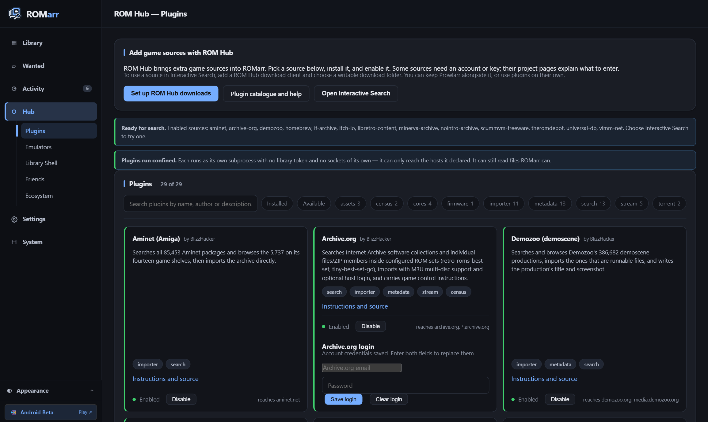

# ROM Hub plugins



**ROM Hub** is the plugin host. A **plugin** adds a source or capability: for example, searching a homebrew catalogue or looking up metadata. Installing ROMarr and installing a plugin are separate steps.

## Is ROM Hub already installed?

| ROMarr installation | Availability |
|---|---|
| Published amd64 or arm64 Docker image | ROM Hub and Git are included. Open **Hub → Plugins** (`/#hub`). |
| Published 32-bit ARM/armv7 Docker image | ROM Hub is not included. Use an amd64/arm64 host for plugins, or use ROMarr's indexers and normal download clients. |
| Proxmox LXC or Python source checkout | Check **Hub → Plugins**. If the host is missing, install it into the same Python environment that runs ROMarr, as below. |
| Native Windows app | The Windows ZIP includes ROM Hub. Linux seccomp confinement is unavailable on Windows. |
| Windows source helper | ROM Hub is optional. The PowerShell helper installs ROMarr's base requirements; see the command below for the additional host package. |

The top of the Plugins page reports whether plugins can run confined on your host. Installing a plugin runs third-party code with access available to the ROMarr process, so read its repository and install sources you trust.

## Install and use a searchable plugin

1. Open **Hub → Plugins**.
2. Search by name or use the `search` capability filter. Read the description and any key requirement.
3. Click **Install**. Confirm the card shows **Enabled**; use **Enable** if needed.
4. Open **Settings → Download Clients → Add** and choose **ROM Hub**. Set a writable save/staging directory as ROMarr sees it, such as `/downloads/rom-hub` in Docker. Test and save.
5. Return to Plugins. It should say **Enabled plugins join search** and list the searchable plugins.
6. Use **Interactive Search** with a title and platform. Plugin results can be grabbed through the ROM Hub client and then go through normal import and verification.

A metadata-only plugin does not become a game search source. Other capabilities, including assets and cores, belong to ROM Hub and may require its CLI; installing them does not automatically configure an emulator or frontend. For a plugin marked **key needed**, follow that plugin's repository instructions for credentials/configuration.

### Archive.org login

On the installed Archive.org card, enter your email and password to save a login. Both fields are required when replacing it. Login does not grant access to files restricted by their owners.

For headless installations, set `ROM_HUB_ARCHIVE_ORG_EMAIL_FILE` and `ROM_HUB_ARCHIVE_ORG_PASSWORD_FILE` to files readable by ROMarr. Alternatively, use `ROM_HUB_ARCHIVE_ORG_EMAIL` and `ROM_HUB_ARCHIVE_ORG_PASSWORD`. File settings take precedence for each field; an incomplete external login is an error and does not fall back to saved credentials. The legacy `ROMARR_ARCHIVE_ORG_*` names are also supported, but do not mix the two families.

Credentials are stored by ROM Hub, not in ROMarr's settings or plugin configuration. Plugins run with the ROMarr service account's filesystem access, so only install plugins you trust. On headless Linux, the default store keeps its encryption key beside the encrypted file; use an externally supplied `ROM_HUB_SECRET_KEY` or an OS keyring if filesystem readers are in your threat model. Do not put passwords in the Nix store.

## Examples in the catalogue

These entries and their tagged source repositories were checked on **2026-10-24**. They are also present in the catalogue pinned by ROMarr's Docker build. This confirms that the plugins are available to install; each upstream service can still be unavailable, change its API, or restrict individual files.

| Plugin | Purpose | Source |
|---|---|---|
| **Homebrew Hub** | Search/import GB/GBC homebrew from gbdev's catalogue | [rom-hub-homebrew v0.3.0](https://github.com/BlizzHacker/rom-hub-homebrew/tree/v0.3.0) |
| **ScummVM freeware games** | Search/import the supported freeware collection | [rom-hub-scummvm-freeware v0.2.0](https://github.com/BlizzHacker/rom-hub-scummvm-freeware/tree/v0.2.0) |
| **Aminet** | Search/import from the Amiga archive | [rom-hub-aminet v0.2.0](https://github.com/BlizzHacker/rom-hub-aminet/tree/v0.2.0) |
| **libretro Thumbnails** | Metadata/artwork capability, rather than game search | [rom-hub-libretro-thumbnails v0.2.0](https://github.com/BlizzHacker/rom-hub-libretro-thumbnails/tree/v0.2.0) |
| **Igir 1G1R Collection Manager** | Igir v5.8.0 1G1R DAT verification, patching (BPS/IPS/UPS/Xdelta3/PMSR) & cleanup for RomM, Gaseous, Retrom, ES-DE & Batocera | [rom-hub-igir v0.1.0](https://github.com/BlizzHacker/rom-hub-igir/tree/v0.1.0) |
| **eXo2romm** | Repackage eXoDOS game zips for standalone RomM playback by rewriting pack-root `dosbox.conf` mounts (credits [derkommutator/eXo2romm](https://github.com/derkommutator/eXo2romm); inspired to assist more users) | [rom-hub-exo2romm v0.1.0](https://github.com/BlizzHacker/rom-hub-exo2romm/tree/v0.1.0) |

eXo2romm only reads and writes inside your configured library folders, download folders, ROMarr data folder and the default eXoDOS paths (`/data/eXoDOS`, `/var/lib/romm/library`). Download-client staging folders count as download folders. To use another folder, add it to the `EXO2ROMM_ROOTS` environment variable of the ROMarr service or container (separate entries with `:` on Linux, `;` on Windows). It is deliberately not a web setting, so an API client cannot widen its own access.

The [full catalogue](https://github.com/BlizzHacker/rom-hub/blob/master/catalog/plugins.json) also includes Archive.org, Demozoo, IF Archive and the expanded **Guides, Tutorials, Open-Source Games/Bots, and Mod Communities** plugins below.

### Expanded Ecosystem: Guides, Tutorials, Open-Source Repos, Mods & Bots

All 11 plugins below implement `search`, `importer`, and `stream` (direct browser view); 10 download full files/releases, while `youtube-tutorials` plans metadata, a thumbnail, and optional captions (streaming the video in-browser without downloading the video file):

| Plugin | Category | What it covers | Key / Solver |
|---|---|---|---|
| **GameFAQs** (`gamefaqs`) | Guides & FAQs | Walkthroughs, FAQs, and maps (`?single=1&print=1` HTML/TXT) | Optional FlareSolverr |
| **StrategyWiki** (`strategywiki`) | Guides & FAQs | Open MediaWiki walkthroughs, chapters, and plain-text guides | None |
| **Game Manuals** (`game-manuals`) | Manuals & Guides | Scanned PDF/CBZ/EPUB player's guides & manuals on Archive.org | None |
| **YouTube Tutorials** (`youtube-tutorials`) | Video Tutorials | Keyless tutorial/walkthrough search, metadata, thumbnails & captions (optional YouTube Data API v3 key) | Optional `api_key` |
| **GitHub Games & Bots** (`github-games`) | Repos & Bots | Open-source games, source ports, game bots (Diablo II, WoW, Minecraft, OSRS), and mod tools (`releases/latest` + source zip) | Optional `github_token` |
| **CurseForge** (`curseforge`) | Mods & Addons | WoW, Minecraft, Stardew Valley, BG3, and more (`api.curseforge.com/v1` + ForgeCDN formula + web fallback) | Optional `api_key` / FlareSolverr |
| **ModDB** (`moddb`) | Mods & Conversions | Classic & modern PC game mods (Diablo II LoD, S.T.A.L.K.E.R., Doom) with 2-step mirror resolution | Optional FlareSolverr |
| **Nexus Mods** (`nexusmods`) | Mods | Anonymous GraphQL v2 search across all Nexus games + v1 file downloads for Premium keys (or browser stream for free) | Optional `api_key` |
| **Modrinth** (`modrinth`) | Mods & Modpacks | Minecraft mods, modpacks, plugins & shaders via open API v2 & direct CDN | None |
| **Thunderstore** (`thunderstore`) | Mods | 100+ modded games (Valheim, Lethal Company, Risk of Rain 2, etc.) | None |
| **GameBanana** (`gamebanana`) | Mods & Tools | Mods, skins, maps, and modding tools via API v11 | None |

### Optional FlareSolverr for Cloudflare-protected Hub sources

For upstream websites that return Cloudflare challenges to plain HTTP requests (such as `gamefaqs.gamespot.com`, `www.moddb.com`, or unauthenticated `www.curseforge.com` web search), enter your **FlareSolverr URL** (for example `http://localhost:8191`) under **Settings → General**, or set `ROM_HUB_FLARESOLVERR_URL`. ROM Hub runs FlareSolverr strictly host-side inside the broker/downloader transport — untrusted plugin subprocesses never receive the solver URL or clearance cookies.

### gamesgamesgamesgamesgames Video Game Standard (`rom-hub-gamesgames`)

The `gamesgames` ROM Hub plugin ([`BlizzHacker/rom-hub-gamesgames`](https://github.com/BlizzHacker/rom-hub-gamesgames)) packages [gamesgamesgamesgamesgames](https://github.com/gamesgamesgamesgamesgames)' decentralized video game data architecture as an opt-in metadata plugin (`[capabilities] metadata`) rather than baking ATProto into ROMarr core:

- **Video Game Lexicons ([gamesgamesgamesgamesgames/lexicon](https://github.com/gamesgamesgamesgamesgames/lexicon))**:
  - `games.gamesgamesgamesgames.game`: Unified open standard for video games with IGDB, Wikidata, and ROMarr/RomM links.
  - `games.gamesgamesgamesgames.release`: Platform editions, dump formats, and cryptographic DAT verification checksums (SHA-256, CRC32, MD5).
  - `games.gamesgamesgamesgames.playState`: Decentralized player progression (`playing`, `completed`, `backlog`, `dropped`, `wishlist`), play time, and ratings synced across your screens.
  - `games.gamesgamesgamesgames.achievement`: Cross-game trophies and achievements recorded on your personal game shelf.
  - `dev.cartridge.verificationRequest`: Verification requests stored in your DID that carry a SHA-256 or CRC32 checksum for a No-Intro or Redump candidate. The plugin does not compare the checksum with DAT data or sign the request.
- **Embedded Gaming AppView ([gamesgamesgamesgamesgames/happyview](https://github.com/gamesgamesgamesgamesgames/happyview))**:
  - In `v0.1.0`, the plugin manifest registers a metadata provider (`enrich`); standalone HTTP XRPC endpoints (`games.gamesgamesgamesgames.getGame`, `listGames`, `getPlayState`) and background Jetstream event indexing are helper classes inside `gamesgames.lexicons` and are not exposed as host HTTP routes unless wired separately.
- **Sovereign Gaming Studio ([gamesgamesgamesgamesgames/cartridge](https://github.com/gamesgamesgamesgamesgames/cartridge))**:
  - Portable, player-owned game libraries and shelf records that travel with your gaming handle across devices.

## Add ROM Hub to a source or LXC installation

Install Git using your operating system's package manager. Then install the host into **ROMarr's own virtual environment**. This example uses the same pinned Hub revision as the Docker image:

```bash
# Proxmox installation path; change it for your own source checkout.
/opt/romarr/.venv/bin/python -m pip install \
  "rom-hub @ https://github.com/BlizzHacker/rom-hub/archive/0d4f7114db4b047bc90a78912574a823e3b10527.tar.gz"
```

For a checkout using `.venv`, use `.venv/bin/python` instead. Installing into system Python or another virtual environment will not make the package available to ROMarr. Refresh the Plugins page after installing; restart ROMarr after a package upgrade if it has already loaded an older module.

For the advanced [Windows source helper](INSTALL.md#windows-source-install), run from the repository directory:

```powershell
.\.venv-windows\Scripts\python.exe -m pip install "rom-hub @ https://github.com/BlizzHacker/rom-hub/archive/0d4f7114db4b047bc90a78912574a823e3b10527.tar.gz"
```

Use your chosen virtual-environment path if you changed `-VenvDirectory`. Git must be on `PATH` when installing plugin repositories. The Hub page reports the lack of Linux sandbox support on Windows; do not assume it is confined there.

### Plugin execution policy

Linux needs a working `pyseccomp` filter for plugin execution by default.
If the Plugins page reports confinement unavailable, install the missing
runtime dependency or use a Linux host with seccomp support. ROMarr itself
continues to run when plugin execution is refused.

On a Linux host whose kernel lacks usable seccomp, an operator can explicitly
set `ROMARR_ALLOW_UNSANDBOXED_PLUGINS=1` in ROMarr's service/container
environment and restart. This runs plugins **with no confinement**; it is not a
filesystem allowlist. Windows and macOS have no seccomp at all, so the desktop
apps run plugins unconfined and the Hub page says so; install only plugins you
trust there. An old
`ROM_HUB_ALLOW_UNSANDBOXED=1` setting alone no longer enables fallback.

Search and fetch do not need library passwords: ROMarr files the results.
Legacy Hub CLI workflows that need the library login can explicitly enable
`ROMARR_PLUGIN_BACKEND_CREDENTIALS=1`. This grants the trusted Hub CLI the
configured backend username/password and preserves URL credentials; it never
grants ROMarr's API key or download-client secrets. Separate credentials
configured deliberately on a plugin remain that plugin's responsibility.

The worker bootstrap uses isolated Python startup and loads the SDK and
seccomp binding before allowing imports from the plugin directory. Existing
plugins use the same manifest, configuration and protocol. Python startup
hooks and shadow SDK packages inside a plugin are not supported extension
points. The sandbox still allows ordinary filesystem reads as ROMarr's user;
install only authors you trust. See [SECURITY.md](../SECURITY.md#plugins--read-this-before-installing-one).

Installed plugin state lives under `ROM_HUB_HOME`. Docker sets this to `/config/rom-hub`, so it survives container recreation when `/config` is mounted. Source installs should set it to a writable persistent directory before starting ROMarr.

## Troubleshooting

| Message or symptom | What to check |
|---|---|
| **ROM Hub is not installed** | Architecture and Python environment in the availability table |
| Plugin installation fails | Git is installed; the repository/ref exists; the host can reach it; Hub's home is writable |
| **Plugins are installed but not part of search yet** | Add, test and save a **ROM Hub** download client |
| A plugin never appears in search | It is enabled and declares `search`; check its supported platforms and source-specific requirements |
| Source returns no files or an access error | Read the plugin's output and upstream access rules; another source may be needed |

Plugin authors can use ROM Hub's [contribution guide](https://github.com/BlizzHacker/rom-hub/blob/master/CONTRIBUTING.md). ROMarr's Plugins page also supports checking a repository URL and submitting a plugin for the shared catalogue.

## Supportive Library Shell, Device Fleet Sync, Igir v5.8.0 & Open-Eyes MCP

ROMarr's **Hub → Library Shell** (`/#portal`), **Hub → Plugins** (`/#hub`), and **System → Ecosystem** (`/#ecosystem`) views empower your existing stack without replacing it:

- **Supportive Library Shell (Iframe Portal)**: Embed **RomM**, **Retrom**, **Gaseous**, **Gameyfin**, or **GG Requestz** directly inside ROMarr with one-click API rescans, Igir v5.8.0 1G1R verification, Netplay SHA-1 hash seeding, and reverse-proxy CSP header guidance.
- **Multi-Device & Network Fleet Manager (`/api/v1/hub/fleet`)**: Synchronize verified 1G1R sets and `gamelist.xml` / Playnite / LaunchBox manifests across local LAN/SMB/NFS shares, SSH/Tailscale handhelds, and cloud WebDAV targets — supporting **ES-DE**, **Raspberry Pi / RetroPie / ArcadePunks / Batocera**, **Argosy Launcher**, **Grout** (muOS/NextUI), **DeckRommSync** (Steam Deck), **SwitchRomM / Tinfoil**, **pkgj / pkgi / fpkgi**, **Kekatsu**, and **RetroArch Cloud Sync**.
- **Igir v5.8.0 1G1R Front-End (`/api/v1/hub/igir`)**: Full GUI and API wrapper for Igir v5.8.0 with native `{romm}`, `{es}`, and `{batocera}` output folder tokens.
- **ROMarr MCP (`/api/v1/mcp`)**: Connect Claude, Codex, Hermes or Antigravity directly to your own server. Streamable HTTP and a portable stdio bridge support API-key authentication. Read-only tools are enabled by default; [setup and permissions](MCP.md). Open-Eyes is a separate optional desktop-control tool.

### Platform-specific searches

Interactive Search translates ROMarr platform names into the identifiers
ROM Hub sources expect. For example, selecting **Sega Genesis / Mega Drive**
queries the plugins as `genesis`; you do not need to clear the platform filter.
The same translation covers TurboGrafx-16, Odyssey 2, ZX81, and Apple II.
Your saved platform choices and library folders stay the same.
